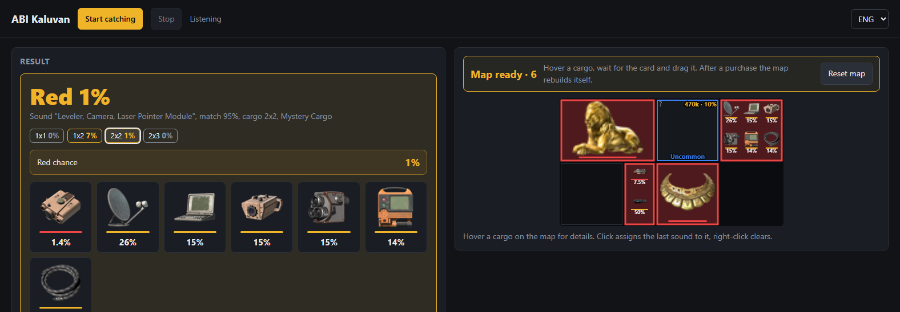

# ABI Kaluvan

**ABI Kaluvan** is a local web app for *Arena Breakout: Infinite*. It helps you work out what is inside the Field Merchant's mystery cargo before you buy it.

The app listens to the game's sound when you drag a cargo, and it watches the merchant window. From these it shows:

- which items the cargo can contain, with a percentage for each;
- the chance that the cargo holds a red (legendary) item.

## Features

- **Sound recognition.** When you drag a cargo, the game plays a pickup sound that depends on the item inside. ABI Kaluvan matches that sound against a library of reference game sounds and narrows down the possible items.
- **Red chance.** The probability combines four inputs: the sound, the cargo size, the cargo label (Common / Uncommon / Rare Mystery Cargo or a category like *Tools*) and the price. Red items appear only in Mystery Cargo of size 1×2, 2×2 or 2×3, and the app takes this into account.
- **Automatic merchant map.**
  - Open the merchant and scroll through the list. The app finds the grid by itself, reads the cargo labels and draws its own map.
  - The map stays frozen while you hover or drag items.
  - The map rebuilds automatically after a purchase.
- **Price from the tooltip.** Hover a cargo and the app reads the price from the in-game tooltip. It then estimates the red chance before you even drag the cargo.
- **Item cards.** The result panel, the map cells and the hover popup all show item icons with per-item odds. Red items are listed first.
- **Game-only capture.** No browser screen sharing is used. The local helper captures:
  - audio from the game process only (WASAPI process loopback);
  - the game window only.
- **UA / ENG / RU** interface.

## Requirements

- Windows 10 (build 20348 or newer) or Windows 11. Earlier builds lack the per-process audio capture that the helper relies on.
- Any Chromium browser (Edge or Chrome).
- The game in **Borderless window** mode. In exclusive fullscreen the game window cannot be captured.

Nothing needs to be installed. The helper is compiled on the fly by the built-in Windows PowerShell.

## Quick start

1. Download or clone this repository.
2. Run **`start.bat`**. A local server starts at `http://localhost:8777/` and the page opens in your browser.
3. Start the game. Then click **Start catching** on the page.
4. Open the Field Merchant, with the cursor outside the grid. Slowly scroll the list to the end and wait for the map to freeze.
5. Use one of two ways to check a cargo:
   - hover a cargo to see its price-based red chance;
   - drag a cargo to hear the sound and get the item breakdown.
6. After you buy something, the map rebuilds by itself.

Close the `start.bat` window to stop the server.

## How it works

| Part | File | What it does |
|---|---|---|
| Local server | `start.bat`, `server.ps1`, `helper.cs` | Compiles the C# helper with PowerShell `Add-Type`. It serves the page over HTTP and streams two things over WebSockets: game audio (`/audio`) and frames of the game window (`/screen`, ~30 fps). |
| Sound matching | `audio.js` | Uses band-limited normalized cross-correlation (5 frequency bands, 0.2 s template) against the game's reference sounds, with per-band onset detection. |
| Sound library | `library.js`, `library/` | Contains the reference sounds, sound → item groups, Field Merchant pools with weights, and item icons. |
| Grid vision | `vision.js` | Detects the merchant grid lines and estimates the cell period. It segments cargo (grey) from empty cells (black) and tracks scrolling via the scrollbar. |
| OCR | `ocr.js`, `lib/tesseract/` | Runs Tesseract.js in the browser. It reads cargo labels and the price from the hover tooltip. |
| UI | `index.html`, `i18n.js` | Combines all of the above into probabilities. It draws the map and handles translations. |

### Red chance

For each cargo, the price is mapped to the closest merchant pool, and the cargo label filters the pool type. The sound then restricts the possible items. Item weights come from the merchant pool data, either for the selected map profile or averaged over all maps. The red chance is the weighted share of red items among the remaining candidates.

## Accuracy notes

- The results are probabilities, not guarantees. Many red and gold items share the same pickup sound. That is why the app shows a percentage instead of a single answer.
- Tooltip OCR uses English trained data. Prices are read in any game language, but item titles only in English.
- For more accurate weights, pick your current map in the **Sounds** panel.

## Credits

- Created by **neverh8me** and **Claude Code**.
- [Tesseract.js](https://github.com/naptha/tesseract.js) (Apache-2.0) for OCR.
- Merchant pool data and item icons come from [abibuilder.com](https://abibuilder.com).

## Disclaimer

This is a fan-made tool and is not affiliated with MoreFun Studios or Tencent. It does not read or modify game memory or files. It only listens to the game's audio output and captures the game window, the same as a screen recorder. Use it at your own risk.
