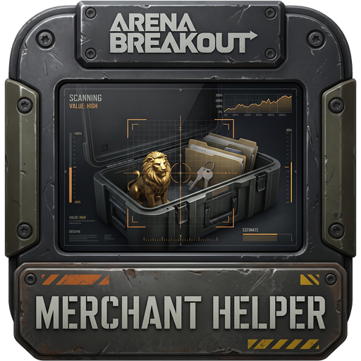
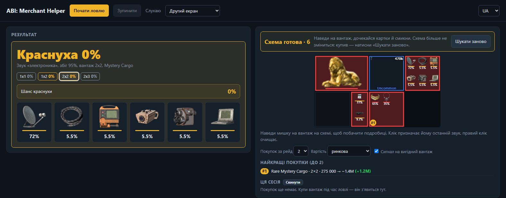
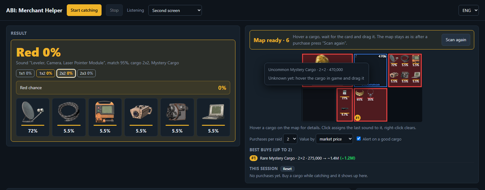

<a href="README.md">English</a> · <b>Українська</b> · <a href="README.ru.md">Русский</a>

# ABI: Merchant Helper

**ABI: Merchant Helper** — локальний вебзастосунок для *Arena Breakout: Infinite*. Він допомагає зрозуміти, що лежить у таємничому вантажі Польового торговця, ще до покупки.

Застосунок слухає звук гри, коли ти тягнеш вантаж, і стежить за вікном торговця. З цього він показує:

- які предмети можуть бути у вантажі й шанс кожного;
- шанс, що у вантажі червоний (легендарний) предмет.

## Можливості

- **Розпізнавання звуку.** Коли тягнеш вантаж, гра програє звук підйому, який залежить від предмета всередині. ABI: Merchant Helper порівнює цей звук з бібліотекою еталонних звуків гри і звужує список можливих предметів.
- **Шанс червоного.** Імовірність складається з чотирьох даних: звук, розмір вантажу, його мітка (Common / Uncommon / Rare Mystery Cargo або категорія, як-от *Tools*) і ціна. Кожен пул торговця має мітку свого вантажу, тож шанси беруться саме з пулів цієї мітки й ціни. Червоні найчастіше випадають із Mystery Cargo, але й із деяких рідкісніших категорій (Rare Collectibles, Rare Medical Supplies, Uncommon Military Items…).
- **Автоматична схема торговця.**
  - Відкрий торговця й прогорни список. Застосунок сам знаходить сітку, читає мітки вантажів і малює свою схему.
  - Готова схема більше не змінюється: наведення, перетягування й підказки з ціною її не збивають.
  - Після покупки натисни **Шукати заново**, щоб перебудувати її.
- **Ціна з підказки.** Наведи на вантаж, і застосунок прочитає ціну з ігрової підказки. Шанс червоного видно ще до того, як ти потягнеш вантаж.
- **Пам'ять покупок.** Після покупки гра пише над сіткою «*нік* spent 200,000 Koen on a mystery cargo and obtained [предмет]». Застосунок читає цей рядок і рахує покупку твоєю, лише якщо твій баланс Koen під сіткою («Owned») зменшився рівно на цю суму. Рядки про покупки інших гравців ігноруються, ніки ніде не зберігаються. Далі сума звіряється з ціною вантажу, звук якого було почуто, і записуються звук, розмір, мітка, ціна та предмет, що випав.
- **Спільна база покупок.** Кожна записана покупка потрапляє в `library/purchases.json`, що йде разом із застосунком. Сторінка ще й щоразу завантажує свіжу базу з GitHub, тож нові дані приходять без нового релізу. Шанси починаються з даних торговця (вони важать як 20 покупок), а база їх уточнює. Що більше покупок зі звуком, то точніший прогноз, особливо для звуків, спільних для кількох предметів.
- **Синхронізація бази під час запуску.** Кожен запуск `start.bat` спершу перевіряє оновлення, а тоді синхронізує базу:
  - копія з GitHub зливається з локальною;
  - нові покупки йдуть на сервер спільної бази — Cloudflare Worker (`worker/worker.js`). Ніки не зберігаються;
  - Worker відкидає все некоректне: невідомі предмети чи звуки, ціни, що не збігаються з жодним пулом торговця, неможливі дати, завеликі пакети. Він також обмежує кількість запитів з однієї IP, а решту дописує в `library/purchases.json` на GitHub. Токен GitHub зберігається лише в секретах Worker.
- **Окупність і найкращі покупки.** Для кожного вантажу з відомою ціною видно, чи він окупається: очікувана вартість того, що випаде, проти ціни, шанс отримати більше, ніж заплатив, і ймовірний діапазон. Вартість можна рахувати за ринковою ціною або за здачею торговцю. Найвигідніші вантажі позначені на схемі #1, #2…, а під схемою їх перелічено стільки, скільки можна купити за рейд (від 2 до 4).
- **Сигнал на вигідний вантаж.** Коли вантаж під курсором окупається або має шанс червоного від 25%, звучить короткий сигнал, а журнал його називає. Вимикається під схемою.
- **Підсумок сесії.** Під схемою: скільки вантажів куплено за сесію, за скільки, скільки червоних і скільки коштують предмети. Там же остання записана покупка, тож одразу видно, що запис спрацював.
- **Стеження за курсором.** Помічник знає, де миша, тож вантаж під нею обведено на схемі, а його шанси видно ще до появи ігрової підказки.
- **Менше хибних звуків.** Звук рахується, лише якщо різко починається, тож вітер і музика його більше не запускають. Якщо в найкращого звуку немає предмета розміру цього вантажу, береться близький другий, що підходить.
- **Автоперепідключення.** Якщо звук або картинка обірвуться, сторінка сама знову підключиться до помічника.
- **Картки предметів.** Панель результату, клітинки схеми й спливна підказка показують іконки предметів із шансом кожного. Червоні йдуть першими.
- **Захоплення лише гри.** Демонстрація екрана в браузері не потрібна. Локальний помічник захоплює:
  - звук лише процесу гри (WASAPI process loopback);
  - лише вікно гри.
- **Один монітор чи два.** Обери **Другий екран**, щоб тримати сторінку на іншому моніторі, або **Оверлей (1 монітор)**, щоб картка результату й схема були в маленькому вікні поверх гри (Chrome або Edge). Постав оверлей на ліву половину екрана: захоплюється лише права, де торговець.
- Інтерфейс **UA / ENG / RU**.

## Вимоги

- Windows 10 (збірка 20348 або новіша) чи Windows 11. У старіших збірках немає захоплення звуку окремого процесу, на якому працює помічник.
- Будь-який браузер на Chromium (Edge чи Chrome).
- Гра в режимі **Вікно без рамки** (Borderless). У повноекранному ексклюзивному режимі вікно гри не захоплюється.

Нічого встановлювати не треба. Помічник компілюється на льоту вбудованим Windows PowerShell.

## Швидкий старт

1. Завантаж або склонуй цей репозиторій.
2. Запусти **`start.bat`**. Локальний сервер стартує на `http://localhost:8777/`, а сторінка відкриється в браузері (за замовчуванням англійською; вибір мови запам'ятовується). Під час першого запуску також з'явиться ярлик **ABI: Merchant Helper** з іконкою на робочому столі та в папці застосунку. Надалі запускай через нього.
3. Запусти гру. Потім натисни на сторінці **Почати ловлю**.
4. Відкрий Польового торговця, тримаючи курсор поза сіткою. Повільно прогорни список до кінця й дочекайся, поки схема зафіксується.
5. Перевір вантаж одним із двох способів:
   - наведи на вантаж, щоб побачити шанс червоного за ціною;
   - потягни вантаж, щоб почути звук і отримати розклад за предметами.
6. Купи вантаж. Покупка запишеться сама, а тоді натисни **Шукати заново**, щоб перебудувати схему.

Щоб зупинити сервер, закрий вікно `start.bat`.

## Оновлення

Під час кожного запуску `start.bat` перевіряє, чи є на GitHub новіший реліз. Якщо є, він запитує `Update now? [Y/n]`. Якщо погодишся, реліз завантажиться, розпакується поверх папки застосунку, і застосунок перезапуститься. Твої звуки й налаштування зберігаються, бо живуть у браузері, а не в папці застосунку.

Якщо новий реліз вийде, поки застосунок працює, вгорі сторінки з'явиться банер. Перезапусти `start.bat`, щоб оновитися.

Без інтернету перевірка тихо пропускається.

## Як це працює

| Частина | Файл | Що робить |
|---|---|---|
| База покупок | `library/purchases.json` | Спільні записи покупок. Завантажуються з папки застосунку та з GitHub і зливаються з твоїми покупками. |
| Синхронізація бази | `sync.ps1`, `worker/` | Під час запуску зливає локальну базу з GitHub і надсилає нові покупки на Worker, який їх перевіряє та комітить у спільну базу. |
| Оновлення | `update.ps1`, `version.json` | Порівнює локальну версію з останнім релізом на GitHub і встановлює його. |
| Локальний сервер | `start.bat`, `server.ps1`, `helper.cs` | Компілює помічник на C# через PowerShell `Add-Type`. Віддає сторінку по HTTP і транслює через WebSocket звук гри (`/audio`) та кадри вікна гри (`/screen`, ~30 кадр/с). |
| Розпізнавання звуку | `audio.js` | Нормована взаємна кореляція по смугах частот (5 смуг, шаблон 0,2 с) з еталонними звуками гри та визначенням початку звуку в кожній смузі. |
| Бібліотека звуків | `library.js`, `library/` | Еталонні звуки, групи «звук → предмети», пули торговця з вагами та іконки предметів. |
| Зір сітки | `vision.js` | Знаходить лінії сітки торговця та розмір клітинки. Відділяє вантажі (сірі) від порожніх клітинок (чорні) і стежить за прокруткою по смузі прокрутки. |
| OCR | `ocr.js`, `lib/tesseract/` | Tesseract.js у браузері. Читає мітки вантажів і ціну з підказки. |
| Інтерфейс | `index.html`, `i18n.js` | Зводить усе це в імовірності, малює схему й відповідає за переклади. |

### Шанс червоного

Для кожного вантажу ціна зіставляється з найближчим пулом торговця, а мітка вантажу визначає тип пулу. Звук далі обмежує можливі предмети. Ваги предметів беруться з даних пулів торговця — для вибраної мапи або в середньому по всіх мапах. Шанс червоного — це зважена частка червоних предметів серед кандидатів, що лишилися.

## Про точність

- Результати — це імовірності, а не гарантії. Багато червоних і золотих предметів мають однаковий звук підйому. Тому застосунок показує відсоток, а не одну відповідь.
- OCR підказки працює з англійськими даними. Ціни читаються за будь-якої мови гри, а назви предметів — лише англійською.
- Для точніших ваг вибери поточну мапу на панелі **Звуки**.

## Автори

- Створено **neverh8me** та **Claude Code**.
- [Tesseract.js](https://github.com/naptha/tesseract.js) (Apache-2.0) для OCR.
- Дані пулів торговця та іконки предметів — з [abibuilder.com](https://abibuilder.com).

## Застереження

Це фанатський інструмент, не пов'язаний із MoreFun Studios чи Tencent. Він не читає й не змінює пам'ять чи файли гри. Він лише слухає звуковий вихід гри та захоплює її вікно, як програма для запису екрана. Використовуй на власний ризик.

## Ліцензія

ABI: Merchant Helper — вільне програмне забезпечення під [GNU General Public License v3.0](LICENSE). Його можна використовувати, вивчати, змінювати й поширювати. Якщо поширюєш змінену версію, вона має лишатися під тією ж ліцензією й іти разом із вихідним кодом.

Сторонні частини в комплекті зберігають власні ліцензії: [Tesseract.js](https://github.com/naptha/tesseract.js) у `lib/tesseract` — Apache-2.0. Звуки гри, дані предметів та іконки в `library/` належать своїм власникам і цією ліцензією не охоплені.
